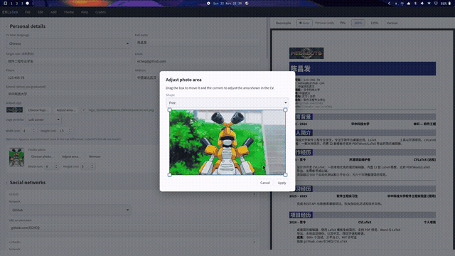

# CVLaTeX

[](LICENSE)

> Cross-platform desktop editor (Windows, Linux, macOS) for building a CV in a form, rendering it with LaTeX templates and compiling it to PDF with a live preview. It also exports Word (.docx) and LaTeX (.tex), and saves or loads projects as `.cvjson`.

## Demo

[](https://github.com/Echeq/CVLaTeX/raw/main/docs/media/videos/demo-en.mp4)

Eight-second preview of the **45-second demo** (MP4, 1.3 MB): sample CV, Chinese template, photo crop and logo. GitHub does not play repository MP4s inline, so the preview is a GIF and the link downloads the full clip. A longer 2–3 minute walkthrough is being prepared for the competition submission.

The recording script and shot list live in
[`docs/competition/demo-script.md`](docs/competition/demo-script.md). Media
naming and replacement rules are in [`docs/media/README.md`](docs/media/README.md).

## Download

These are the recommended downloads for most users: self-contained builds that need **no Python and no LaTeX installation**. The app can install TinyTeX on first run when you want PDF preview and export.

| Platform | Download |
| --- | --- |
| Windows x64 | [CVLaTeX-v1.0.0-windows-x64.zip](https://github.com/Echeq/CVLaTex/releases/download/v1.0.0/CVLaTeX-v1.0.0-windows-x64.zip) |
| macOS Apple Silicon (arm64) | [CVLaTeX-v1.0.0-macos-arm64.zip](https://github.com/Echeq/CVLaTex/releases/download/v1.0.0/CVLaTeX-v1.0.0-macos-arm64.zip) |
| Linux x86_64 | [CVLaTeX-v1.0.0-linux-x86_64.tar.gz](https://github.com/Echeq/CVLaTex/releases/download/v1.0.0/CVLaTeX-v1.0.0-linux-x86_64.tar.gz) |
| Checksums | [SHA256SUMS.txt](https://github.com/Echeq/CVLaTex/releases/download/v1.0.0/SHA256SUMS.txt) |

All four files are attached to the [v1.0.0 release](https://github.com/Echeq/CVLaTex/releases/tag/v1.0.0). **v1.0.0 is the first stable release** and the first one published under the CVLaTeX asset name; v0.3.0 was the last pre-release and used the historical `CVLaTex` spelling. The macOS build is Apple Silicon only; Intel Macs are not supported. All 12 templates, the web assets and the Linux PDF.js viewer ship inside every bundle.

## Requirements

- Windows 10/11 with the WebView2 runtime (preinstalled on current Windows), macOS with the built-in WKWebView, or Linux with WebKitGTK 4.1 plus GObject introspection (`python3-gi`, `gir1.2-webkit2-4.1`; the WebKitGTK 4.1 runtime library is pulled in by these packages on Debian/Ubuntu). Building a bundle additionally needs the `libwebkit2gtk-4.1-dev` package, because PyInstaller must import `gi` and the GTK backend; running from source or from the bundle does not require `-dev`.
- To run from source: Python 3.12 with pip, plus the packages in `requirements.txt`. The standalone bundles need no Python installation.
- A LaTeX engine is optional. Preview and PDF export need one, but the app can download and install TinyTeX itself on all three platforms; Word (.docx) and LaTeX (.tex) export never need a LaTeX installation.

## Installation

For most users: download the archive above, extract it, and run the app. No Python or LaTeX installation is required; the app can install TinyTeX on first run. On first run the language picker asks for the interface language and the app starts with a blank CV; `Edit → Load sample CV` fills it with a fictional example when you want one.

### Windows

1. Download and extract the `.zip`.
2. Run `CVLaTeX.exe`.
3. Windows SmartScreen will warn because the build is unsigned: click **More info → Run anyway**.
4. WebView2 is required and normally preinstalled on Windows 10/11; if missing, install the [Microsoft Edge WebView2 Runtime](https://developer.microsoft.com/microsoft-edge/webview2/).
5. On first run, let the app install TinyTeX if you want PDF preview/export.

### macOS

1. Download and unzip; drag `CVLaTeX.app` to Applications (optional).
2. Open it. If Gatekeeper blocks it, right-click the app → **Open**, or use **System Settings → Privacy & Security → Open Anyway**.
3. This build is **Apple Silicon (arm64) only**; Intel Macs are not supported.
4. Let the app install TinyTeX if you want PDF preview/export.

### Linux

1. Install the runtime packages: Debian/Ubuntu `sudo apt install python3-gi gir1.2-webkit2-4.1`; Arch `sudo pacman -S python-gobject webkit2gtk-4.1`.
2. Extract and run:

   ```bash
   tar -xzf CVLaTeX-v1.0.0-linux-x86_64.tar.gz
   chmod +x CVLaTeX
   ./CVLaTeX
   ```

3. `libwebkit2gtk-4.1-dev` is build-only and not needed to run.
4. Let the app install TinyTeX if you want PDF preview/export.

### From source

Linux:

```bash
sudo apt-get install python3-gi gir1.2-webkit2-4.1 python3-venv
python3 -m venv --system-site-packages .venv
.venv/bin/pip install -r requirements.txt
.venv/bin/python main.py
```

Add `libwebkit2gtk-4.1-dev` only when building a bundle with `./build.sh`; it is not needed to run from source.

macOS:

```bash
python3 -m venv .venv
.venv/bin/pip install -r requirements.txt
.venv/bin/python main.py
```

Windows (PowerShell):

```powershell
python -m venv .venv
.venv\Scripts\pip install -r requirements.txt
.venv\Scripts\python.exe main.py
```

On Linux the `--system-site-packages` flag is required so the venv sees the distro PyGObject/WebKitGTK packages; on macOS it is unnecessary. Full setup, test and build instructions are in [docs/DEVELOPMENT.md](docs/DEVELOPMENT.md).

## Releases

**v1.0.0 is the first stable release.** The direct downloads are in [Download](#download) and the same files are attached to the [v1.0.0 release](https://github.com/Echeq/CVLaTex/releases/tag/v1.0.0). (v0.1.0 was uploaded manually; v0.2.0 was the first archive set produced by the release workflow; v0.2.1 fixed the Linux bundle startup failure; v0.3.0 was the last pre-release.)

| Platform | Architecture | Asset |
| --- | --- | --- |
| Windows | x64 | `CVLaTeX-v1.0.0-windows-x64.zip` (contains `CVLaTeX.exe`) |
| Linux | x86_64 | `CVLaTeX-v1.0.0-linux-x86_64.tar.gz` (contains `CVLaTeX`) |
| macOS | Apple Silicon (arm64) | `CVLaTeX-v1.0.0-macos-arm64.zip` (contains `CVLaTeX.app`) |
| All platforms | — | `SHA256SUMS.txt` |

GitHub's `macos-latest` runner currently builds natively on Apple Silicon, so
the v1.0.0 macOS asset is named `CVLaTeX-v1.0.0-macos-arm64.zip`. No universal
macOS binary and no Intel macOS build are produced for v1.0.0.

Verify a download with the checksum manifest (Linux/macOS, with the downloaded
files and `SHA256SUMS.txt` in the current directory):

```bash
sha256sum -c SHA256SUMS.txt
```

On Windows, compare `Get-FileHash -Algorithm SHA256 <file>` with the matching
line in `SHA256SUMS.txt`.

**Unsigned builds:** the Windows and macOS bundles are not code-signed or
notarized. Windows SmartScreen may warn about the executable, and macOS
Gatekeeper may block the `.app` on first launch (open it from Finder with
right-click → Open, or allow it in System Settings → Privacy & Security).
Verify the SHA-256 checksum and build provenance before running a bundle.

**Linux runtime:** the bundle needs WebKitGTK 4.1 and GObject introspection from
your distribution — on Debian/Ubuntu `python3-gi` and
`gir1.2-webkit2-4.1` (the build-only `libwebkit2gtk-4.1-dev` is needed only
when building), on Arch `python-gobject` and `webkit2gtk-4.1`.

Release notes live in [CHANGELOG.md](CHANGELOG.md), the security policy in
[SECURITY.md](SECURITY.md) and the third-party licenses in
[THIRD_PARTY_NOTICES.md](THIRD_PARTY_NOTICES.md).

## Usage

The form is on the left and the compiled preview on the right; changes are recompiled automatically while typing (configurable in Settings). On Windows and macOS the preview is the webview's native PDF viewer. On Linux, where WebKitGTK cannot render PDFs inline, it is drawn by the PDF.js build vendored in `web/pdfjs/` and served locally at `/pdfjs/`. If PDF.js fails to load or render, the notice above the preview offers **Open PDF with the system viewer**, which opens the last compiled PDF with the desktop's default viewer.

### Templates

`Edit → CV template` groups the 12 templates into ATS Friendly (Classic, Harvard (academic)), Chinese styles (Chinese (standard), Black tabs, Blue ribbon, Navy minimal, Playful, Sword) and Normal CV (Modern, Creative, Sidebar (left), Sidebar (right)).

The Sidebar layout paints a full-height accent bar on the left of the first page only, holding the photo, school logo, contacts, social networks and extra details, while the main column keeps the name/profession header and the professional sections; the first page reserves about 7 cm on the left for the bar (ignoring the left margin setting) and pages 2+ use the configured margins and the full text width. Sidebar (right) mirrors the same layout with the bar on the right of the first page only, reserving about 7 cm on the right (ignoring the right margin setting) and using the configured margins and full text width afterwards. TeX fixes line breaks before pagination, so a single paragraph that straddles the page 1/2 break keeps its first-page line width; breaks between sections or entries reflow normally.

Chinese (standard) renders with a per-OS CJK font fallback (Microsoft YaHei, PingFang SC, Noto Sans CJK SC, WenQuanYi Zen Hei, Source Han Sans SC) and switches compilation to XeLaTeX automatically. Black tabs wraps every page in a heavy frame with black section tabs, Blue ribbon uses a slanted blue header band and a gold accent, Navy minimal keeps navy rules and dense three-column academic entries, Playful combines a large name, badge-style headings, diamond bullets and purple links, and Sword pairs a slanted navy name banner with a two-column contact grid (personal data on the left, profile links on the right, no row hairlines) and navy section plates over gray bars.

Every header shows the person's name as its main element instead of a redundant "resume" label, and long names shrink automatically to fit their banner or column.

### Form and sections

- A new CV starts with **Personal details only**. The top **Add** menu is organized by purpose:
  - **Sections** — Profile, Education, Work, Internships, Projects, Campus activities, Skills, Languages, References, plus Custom section, Period + description and Columns list.
  - **Extras** — Social networks and Extra details (custom label/value pairs shown in the header).
  - **Separators** — line, color band and blank space.
  - **Manage custom content** — edit, move or delete anything created from Sections/Extras/Separators.
- Sections with content from a saved CV or the sample are shown automatically. Empty sections stay out of the form until added.
- The form uses two columns when the panel is wide and one field per row when it is narrow; the school logo gets its own full-width row and the photo controls stay grouped in a compact media card.
- Each section header lets you rename it inline, hide/show it, move it up or down and **remove it** (with confirmation; its content is cleared and the section returns to Add). The five entry-list sections support 1–3 columns.
- If the form has no body sections yet, a short hint points to **Add** and to the sample CV.

### Sample CV

`Edit → Load sample CV` fills the form in the current `CV label language` (Spanish, English or Chinese), independent of the selected template. It uses the project's public sample identity: Elvis Enrique Chen Qiu / 陈昌发, Software Engineering at HUST, GitHub/LinkedIn `ECHEQ`, the example address `echeq@github.com` and the fake phone `123-456-78`. It includes one free separator block so the sample also demonstrates the dividers.

### Custom content

The `Add → Sections` submenu also contains the free-form section types:

- `Custom section` with a title and multi-line content.
- `Columns list` (1–3) with title/detail pairs.
- `Period + description` list.

`Add → Separators` inserts a line, a color band or blank space. These blocks are anchored to the start, after a section, or to the end, and can be moved. **Click a list or custom block row to edit it directly**; the Edit button is still there, but it is no longer required. New blocks are scrolled into view, and new sections/social/extra cards focus their first field. The **Custom content** card at the bottom of the form only appears when there is at least one block. `Add → Manage custom content…` edits, moves and deletes them. A block anchored to a hidden section keeps its position. In the Word export, free-block columns stay a single column.

### Document colors

`File → Settings` includes the Document colors fieldset (Primary, Secondary, Text, Gray). Each color can be typed as `#RRGGBB`, picked with the color wheel, or reset with `Auto`; an empty field uses the template's own color. The palette affects the exported document (PDF, Word, .tex), not the UI theme.

### Typography

`File → Settings` also includes the typography controls:

- **Font size** offers 9, 10, 11, 12 and 14 pt. The LaTeX `article` class only accepts 10/11/12 pt, so 9 and 14 pt use the `scrextend` package when it is available and fall back to the nearest standard size otherwise. The template's fixed heading sizes are not scaled.
- **Font style** keeps the template's own typography by default, or forces Serif, Sans serif or Monospace. It affects the PDF, the Word export and the exported `.tex`.

Both settings are global preferences and never change the interface theme. Listing the fonts installed on the computer is not implemented yet: it requires XeLaTeX and is planned for a later release.

### CV guides by market

Hiring conventions differ by country. These source-backed guides explain
length, photo, personal data, section order, ATS advice and the closest
CVLaTeX settings for each market:

- [United States](docs/markets/en-US.md) — one page, US Letter, no photo.
- [United Kingdom](docs/markets/en-GB.md) — two A4 pages, no photo, UK spelling.
- [Spain](docs/markets/es-ES.md) — one or two A4 pages, photo optional.
- [Latin America](docs/markets/es-LATAM.md) — country-specific; photo optional.
- [China](docs/markets/zh-CN.md) — one A4 page, education first, professional photo usually expected, single-column layout.
- [Russia](docs/markets/ru-RU.md) — hh.ru structure; Russian CV labels pending.

The same summaries are available inside the app under
`Help → Dedicated to each market`, with a link back to the full guide.

### UI language and document language

- **UI language** applies to the interface. On first launch CVLaTeX asks for it (English preselected) before the LaTeX setup wizard; the choice is stored in the preferences and applied instantly, including the window title. `File → Settings → Interface language` offers English (default), Español, 中文 and Русский and can change it later.
- **Document language** is the per-CV `CV label language` field (Spanish, English or Chinese; no Russian option). It selects the labels, fonts and engine used to render the CV. A new CV defaults to the UI language (English when the UI is Russian); the value is then saved with the document, so saved CVs keep their language and do not follow later UI changes.

### Export, import and save

- `File → Export → PDF…` compiles the document (requires a LaTeX engine).
- `File → Export → LaTeX…` writes the generated `.tex` with the data block embedded as comments.
- `File → Export → Word (.docx)…` writes a `.docx` with python-docx (no LaTeX needed) that follows the selected template instead of one generic layout: the header composition, section-heading shape, entry lines (right-tabbed date/title lines in the Latin templates, three-column entries in the Chinese-style ones), bullet markers and separators are reproduced with the template palette, and Preferences override its colors. The Latin templates also honour the 1–3 columns of the five entry-list sections; the Chinese-style templates keep their three-column entries and ignore that setting, as in the PDF.
- `File → Import LaTeX (.tex)…` rebuilds the form from the data block embedded in a CVLaTeX `.tex`; files without it are rejected with an alert.
- `File → Save…` / `File → Open…` use the `.cvjson` project format: version 3 stores the data plus the photo and logos embedded in base64. v1/v2 files are accepted and migrated (a backup copy with the `.v2.bak` suffix is written first, never clobbering an existing one).
- Autosave writes unsaved changes to the app data directory (`%LOCALAPPDATA%\CVLaTeX` on Windows, `~/Library/Application Support/CVLaTeX` on macOS, `$XDG_DATA_HOME/CVLaTeX` or `~/.local/share/CVLaTeX` on Linux); on the next start CVLaTeX offers to recover it only if it differs from an empty CV. Closing the window with unsaved changes opens a guard with Save / Exit without saving / Cancel; Save writes to the current `.cvjson` (and asks for a path when the CV has none yet).

The Word layout is an approximation built from WordprocessingML primitives, not a pixel copy of the PDF. Shapes are built from shading and borders rather than DrawingML or VML, and nothing is rotated, so the slanted ornaments (the Sword blade tip, the Blue ribbon wing) are drawn as stair-stepped bars. The Sidebar bar starts at the top margin instead of the paper edge and continues on later pages, while the PDF draws that bar on page 1 only; on the last page it ends with the content. Fonts are written explicitly (Cambria, Calibri for Playful, Microsoft YaHei for CJK), so a machine without them gets the system substitution. Word's line breaking and pagination differ from TeX, and free-block columns stay single-column.

### Photo and logos

`Choose photo…` normalizes the image (JPEG, longest side ≤ 1600 px) and opens the crop editor with the full image selected; cancelling keeps the normalized image, and `Adjust area…` reopens the crop later. The applied crop is saved as JPEG ≤ 1600 px. Entry logos are normalized to PNG ≤ 512 px (no crop). The **school logo** is optional. With **Left corner** it is a letterhead mark above the name; with **Right corner** it shares the reserved media column with the photo, so the left-hand name/contact text keeps its position. The logo width/height are adjustable in centimetres and clamped to the media column/bar. When you choose one, the crop editor opens with a locked wide area (2:1, 3:1 or 4:1, default 3:1), so it reads as a long institutional logo; `Adjust area…` reopens it. The photo and logo start at the top margin, level with the name, with a clear gap between them. The profile-photo crop also offers Free, 1:1, 4:5 and 3:4 shapes. `Settings → Measurement units` switches the photo width/height fields between centimetres and inches without changing the saved document. **Harvard** is intentionally photo-free; the form shows a notice instead of the photo field. US, UK and Canada ATS guidance is to leave the logo empty; some campus or Chinese applications use it as a familiar institutional mark.

### Window layout

The app opens **side by side**. The **Vertical / Side by side** button in the preview bar switches to the stacked layout (preview above, form below) and **keeps that choice**; no automatic switching. Drag the horizontal divider to resize the preview; double-click resets it to 50%. Both split positions are remembered. For advanced users, `File → Settings → Layout` also offers `Automatic` (stacks on narrow, portrait or half-screen windows) and the breakpoint field used by that mode.

### Shortcuts

Ctrl+S saves, Ctrl+O opens, Ctrl+N starts a new CV, Ctrl+Enter recompiles, Ctrl+Z / Ctrl+Y (or Ctrl+Shift+Z) undo/redo. The preview zooms to 75%, 100% or 125%, and the form/preview split can be dragged in either orientation (double-click resets the current one to 50%).

### Privacy and local security

CVLaTeX works entirely offline after installation: no account, telemetry, cloud sync or remote API. The interface is served by a local server bound to a random `127.0.0.1` port with a per-session token, strict `Host`/`Origin` checks, a Content Security Policy and confined `/media/` and `/preview/` routes. The local pywebview bridge requires `'unsafe-eval'` in that policy; no remote content is loaded. Images are limited to 12 MB and `.cvjson` projects to 50 MB, and uploaded images are validated by magic bytes. TinyTeX downloads are verified against pinned SHA-256 digests; a custom mirror must use HTTPS and publish its checksum. The Windows and macOS bundles are still unsigned and not notarized, so verify the published SHA-256 manifest before running them. The full policy is in [SECURITY.md](SECURITY.md).

## LaTeX engine

PDF preview and export need a LaTeX engine. `pdflatex` is resolved in this order:

1. The `latex_path` preference, set from `Settings → LaTeX engine → Change path…`.
2. TinyTeX installed by the app in the app data directory (`tinytex/`).
3. A TinyTeX installation left in the previous `CVLaTex` app directory.
4. The usual manual locations: `%APPDATA%\TinyTeX` and `%LOCALAPPDATA%\TinyTeX` (Windows), `~/Library/TinyTeX` and `/Library/TeX/texbin` (macOS), `~/.TinyTeX` and `/usr/local/texlive/*` (Linux).
5. `pdflatex` on the `PATH` (MiKTeX, TeX Live, MacTeX).

`Settings → LaTeX engine → Check` scans all of those locations, remembers the first working engine and shows a diagnostics panel when nothing is found. This fixes the common case where TinyTeX is installed but the desktop app did not inherit the shell `PATH`.

On first run, after the interface-language picker, the setup wizard offers to download and install TinyTeX automatically on Windows, Linux and macOS. Official assets are verified against SHA-256 digests pinned in the app for the exact release; a missing checksum or a mismatch aborts the install. The installation can be cancelled while in progress. Chinese text or a `fontspec` preamble switches to `xelatex` automatically. Word export requires no engine.

If GitHub is slow or blocked, the download resumes with HTTP `Range` after a failure, retries, and then falls back to a SourceForge mirror. You can also paste a trusted mirror URL in `Settings → LaTeX engine → Download mirror`, but it must use **HTTPS** and publish a `<url>.sha256` file; otherwise the install aborts. **Download manually…** and **Install from downloaded file…** accept a local archive that you provide, which is trusted as-is. A bad archive never deletes a working installation: extraction is validated in a staging folder and swapped atomically.

## Troubleshooting

- **"No LaTeX engine found" or the "No LaTeX engine is configured" warning**: open `Settings → LaTeX engine → Check`; it scans the app folder, the previous `CVLaTex` folder, the usual TinyTeX/MiKTeX/TeX Live locations and `PATH`. If it still fails, open **Diagnostics** there and set the `pdflatex` binary with **Change path…** (for example `%APPDATA%\TinyTeX\bin\windows\pdflatex.exe`, `~/Library/TinyTeX/bin/universal-darwin/pdflatex` or `~/.TinyTeX/bin/x86_64-linux/pdflatex`). Preview and PDF export stay disabled until an engine is found.
- **TinyTeX download is slow or stuck (for example in mainland China)**: the installer resumes partial downloads and retries, then tries a SourceForge mirror. For a faster path, use **Download manually…** in the wizard, download the asset with a download manager or a trusted mirror, and choose **Install from downloaded file…**. You can also paste a trusted mirror URL in `Settings → LaTeX engine → Download mirror`, but it must use HTTPS and publish a `<url>.sha256` file; a missing checksum aborts the install. A local archive chosen manually is trusted as-is.
- **TinyTeX installation failed halfway**: the previous installation is preserved. The new archive is extracted into a staging folder and validated before the swap; a corrupt archive leaves the old engine usable.
- **Top-menu clicks land in the wrong place after resizing (Hyprland/Wayland)**: this is a known Hyprland input bug ([hyprwm/Hyprland#9277](https://github.com/hyprwm/Hyprland/issues/9277)): after a surface resize, clicks use stale pointer coordinates until the pointer moves. Move the mouse once after resizing, or update Hyprland. The app's menu hit boxes are correct (and their target area is now larger); the compositor owns the pointer coordinates.
- **Linux: the integrated preview is empty**: the preview is rendered with the bundled PDF.js, so a blank preview usually means `web/pdfjs/` was not bundled (the build includes it via `--add-data`) or PDF.js failed to load. The notice then offers **Open PDF with the system viewer**, which opens the last compiled PDF with the desktop's default viewer as a fallback.
- **Linux: the app does not start / no webview**: install the WebKitGTK/gir runtime packages from [Requirements](#requirements) (`python3-gi`, `gir1.2-webkit2-4.1`; add the build-only `libwebkit2gtk-4.1-dev` package only if you are building a bundle).
- **Linux bundle exits with `You must have either QT or GTK...` or `No module named 'gi'`**: the build machine's venv could not see the distro PyGObject, so the bundle shipped without the GTK backend. Install the system packages from [Requirements](#requirements) and rebuild with `./build.sh`; it recreates the venv with `--system-site-packages` so PyInstaller can import `gi`.
- **Missing LaTeX package**: the errors shown under the preview name the problem; install the package with your TeX distribution's manager or re-run the TinyTeX installer.
- **A `.tex` file is rejected on import**: only files generated or exported by CVLaTeX can be imported, because they carry the embedded data block. Foreign LaTeX files are not parsed heuristically.
- **Saving from the embedded PDF viewer does nothing**: downloads are enabled in the WebView so the viewer's save button opens the native dialog; if it still fails, use `File → Export → PDF…`.
- **Building on Windows cannot replace the executable**: close the running app first; Windows locks the executable while it runs.
- **A bundle built on one OS does not run on another**: bundles are per-platform; build natively or use the CI artifacts.

## Development

Install the test dependencies and run the suite:

```bash
.venv/bin/pip install -r requirements-dev.txt
.venv/bin/python -m pytest -m "not latex" -q   # fast loop: skips LaTeX compiles
.venv/bin/python -m pytest -n auto             # full suite, parallel
```

The fast loop excludes the slow PDF compilations, so use it while iterating and run the full suite before opening a pull request. The PDF compile tests are skipped, not failed, when `pdflatex`/`xelatex` are not installed. Validate the frontend syntax without a browser (optional, needs Node):

```bash
node --check web/app.js
node --check web/i18n.js
```

Build the release archives with `./build.sh` on Linux/macOS or `build.bat` on Windows. Each script stages the public assets, runs PyInstaller and calls `tools/package_release.py`, producing `dist/CVLaTeX-v1.0.0-linux-x86_64.tar.gz`, `dist/CVLaTeX-v1.0.0-macos-arm64.zip` and `dist/CVLaTeX-v1.0.0-windows-x64.zip`. The raw `dist/CVLaTeX_Linux`, `dist/CVLaTeX.app` and `dist/CVLaTeX.exe` stay available for local runs.

Setup for all platforms, architecture, testing strategy and the guides for adding templates or data fields are in [docs/DEVELOPMENT.md](docs/DEVELOPMENT.md). Competition, market and media material lives in [`docs/competition/`](docs/competition/README.md), [`docs/markets/`](docs/markets/README.md) and [`docs/media/`](docs/media/README.md).

## Contributing

Contributions are welcome. Read [CONTRIBUTING.md](CONTRIBUTING.md) for the workflow and [docs/DEVELOPMENT.md](docs/DEVELOPMENT.md) for setup.

## License

MIT — see [LICENSE](LICENSE).
