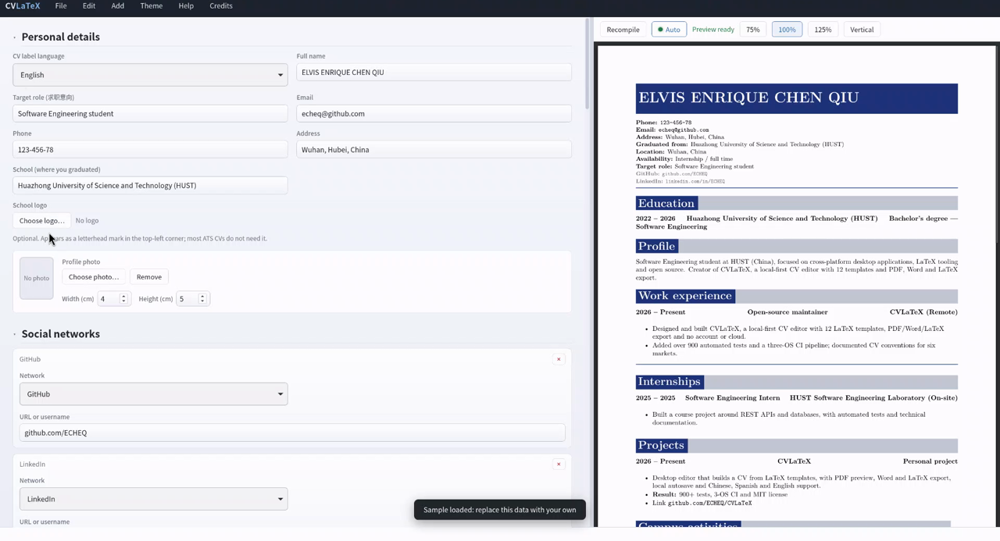

# CVLaTeX

[English](README.md) | **中文**

[](LICENSE)

> CVLaTeX 是一款跨平台桌面简历编辑器（Windows / Linux / macOS）：在表单中填写内容，使用 LaTeX 模板实时排版并编译为 PDF，同时支持导出 Word（.docx）和 LaTeX（.tex），项目文件保存为 `.cvjson`。

## 演示

[](https://echeq.github.io/CVLaTeX/demo.html)

**45 秒演示**（基于 v1.0.1 构建）：首次启动、示例简历、中文模板、照片裁剪与导出。点击图片即可在浏览器中播放。

## 项目亮点（评审速览）

- 原创开源软件，2026 年首次公开发布，采用 MIT 许可证，符合“2021 年 9 月 1 日之后发布的原创开源软件”赛道要求。
- 支持 Windows、Linux、macOS 三个平台，GitHub Actions 三平台持续集成。
- 内置 12 套模板，包含 6 套中文风格模板，中文内容自动切换 XeLaTeX。
- 完全离线：无账号、无订阅、无云端上传，简历和照片只保存在本机。
- 表单化编辑，不需要学习 LaTeX；同时保留 PDF、Word、LaTeX 三种输出。
- **1032 个测试通过**（其中快速套件 923 个），覆盖数据模型、模板、导出、HTTP 服务、安全与发布流程。
- 本地 HTTP 服务带会话令牌、Host/Origin 校验、CSP 和上传大小限制；TinyTeX 下载使用固定 SHA-256 校验。

## 下载

推荐使用自带运行环境的发行包，**无需安装 Python，也无需预先安装 LaTeX**。如需 PDF 预览和导出，应用可以在首次运行时下载并安装 TinyTeX。

| 平台 | 下载 |
| --- | --- |
| Windows x64 | [CVLaTeX-v1.0.1-windows-x64.zip](https://github.com/Echeq/CVLaTex/releases/download/v1.0.1/CVLaTeX-v1.0.1-windows-x64.zip) |
| macOS Apple Silicon（arm64） | [CVLaTeX-v1.0.1-macos-arm64.zip](https://github.com/Echeq/CVLaTex/releases/download/v1.0.1/CVLaTeX-v1.0.1-macos-arm64.zip) |
| Linux x86_64 | [CVLaTeX-v1.0.1-linux-x86_64.tar.gz](https://github.com/Echeq/CVLaTex/releases/download/v1.0.1/CVLaTeX-v1.0.1-linux-x86_64.tar.gz) |
| 校验和 | [SHA256SUMS.txt](https://github.com/Echeq/CVLaTex/releases/download/v1.0.1/SHA256SUMS.txt) |

以上文件均附在 [v1.0.1 发行版](https://github.com/Echeq/CVLaTex/releases/tag/v1.0.1) 中。**v1.0.1 是最新稳定补丁版**；v1.0.0 是首个正式稳定版，v0.3.0 为最后一个预发布版。macOS 仅支持 Apple Silicon，不支持 Intel Mac。

## 系统要求

- Windows 10/11，需要 WebView2 运行时（当前 Windows 通常已预装）；macOS 使用系统自带 WKWebView；Linux 需要 WebKitGTK 4.1 和 GObject introspection（Debian/Ubuntu：`python3-gi`、`gir1.2-webkit2-4.1`；Arch：`python-gobject`、`webkit2gtk-4.1`）。从源码构建发行包时还需要 `libwebkit2gtk-4.1-dev`，仅运行不需要。
- 从源码运行：Python 3.12、pip，以及 `requirements.txt` 中的依赖。发行包不需要安装 Python。
- LaTeX 引擎是可选的：PDF 预览和导出需要它，但应用可以在三个平台自动下载安装 TinyTeX；Word（.docx）和 LaTeX（.tex）导出不需要 LaTeX。

## 安装

每个平台都有 **两种运行方式**：

| 平台 | 方式 A：发行包 | 方式 B：Python 源码 |
| --- | --- | --- |
| Linux | 下载 `.tar.gz`，解压后运行 `./CVLaTeX` | 克隆仓库，创建虚拟环境，运行 `main.py` |
| Windows | 下载 `.zip`，解压后运行 `CVLaTeX.exe` | 克隆仓库，创建虚拟环境，运行 `main.py` |
| macOS | 下载 `.zip`，打开 `CVLaTeX.app` | 克隆仓库，创建虚拟环境，运行 `main.py` |

每个发行包都包含应用程序和**全部文档文件**：`README.md`、`LICENSE`、`THIRD_PARTY_NOTICES.md`、`CHANGELOG.md` 和 `SECURITY.md`。如需校验，请同时下载 `SHA256SUMS.txt`。

普通用户下载对应平台的压缩包，解压后直接运行即可。无需安装 Python 或 LaTeX；如需 PDF，应用可以在首次运行时安装 TinyTeX。首次启动会先选择界面语言，然后进入空白简历；需要示例时使用 `Edit → Load sample CV`。

### Windows

**方式 A — 发行包**

1. 下载 `CVLaTeX-v1.0.1-windows-x64.zip` 和 `SHA256SUMS.txt`。
2. 解压整个 `.zip`（包含应用和全部文档）。
3. 运行 `CVLaTeX.exe`。
4. 由于构建未签名，SmartScreen 可能提示；点击 **More info → Run anyway**。
5. 如系统缺少 WebView2，安装 [Microsoft Edge WebView2 Runtime](https://developer.microsoft.com/microsoft-edge/webview2/)。
6. 如需 PDF 预览/导出，允许应用安装 TinyTeX。

**方式 B — Python 源码**

要求：Python 3.12 和 Git。PDF 预览/导出需要 LaTeX，但可以在应用内安装 TinyTeX。

```powershell
git clone https://github.com/Echeq/CVLaTeX.git
cd CVLaTeX
python -m venv .venv
.venv\Scripts\pip install -r requirements.txt
.venv\Scripts\python.exe main.py
```

### macOS

**方式 A — 发行包**

1. 下载 `CVLaTeX-v1.0.1-macos-arm64.zip` 和 `SHA256SUMS.txt`。
2. 解压后在文件夹中会看到 `CVLaTeX.app` 和全部文档。
3. 将 `CVLaTeX.app` 拖入 Applications（可选）。
4. 打开应用。若 Gatekeeper 阻止，右键 → **Open**，或在 **System Settings → Privacy & Security → Open Anyway** 中允许。
5. 该构建仅支持 **Apple Silicon（arm64）**，不支持 Intel Mac。
6. 如需 PDF 预览/导出，允许应用安装 TinyTeX。

如果 macOS 提示 **“CVLaTeX.app is damaged and can’t be opened”**，这不是文件损坏，而是未签名应用的 Gatekeeper 隔离。先核对 SHA-256，然后运行：

```bash
xattr -dr com.apple.quarantine /Applications/CVLaTeX.app
```

如果仍无法打开：

```bash
sudo codesign --force --deep --sign - /Applications/CVLaTeX.app
sudo xattr -cr /Applications/CVLaTeX.app
open /Applications/CVLaTeX.app
```

**方式 B — Python 源码**

要求：Python 3.12 和 Git。PDF 预览/导出需要 LaTeX，但可以在应用内安装 TinyTeX。

```bash
git clone https://github.com/Echeq/CVLaTeX.git
cd CVLaTeX
python3 -m venv .venv
.venv/bin/pip install -r requirements.txt
.venv/bin/python main.py
```

### Linux

**方式 A — 发行包**

1. 安装运行依赖：Debian/Ubuntu 使用 `sudo apt install python3-gi gir1.2-webkit2-4.1`；Arch 使用 `sudo pacman -S python-gobject webkit2gtk-4.1`。
2. 下载 `CVLaTeX-v1.0.1-linux-x86_64.tar.gz` 和 `SHA256SUMS.txt`。
3. 解压整个压缩包并运行：

   ```bash
   tar -xzf CVLaTeX-v1.0.1-linux-x86_64.tar.gz
   chmod +x CVLaTeX
   ./CVLaTeX
   ```

4. `libwebkit2gtk-4.1-dev` 仅构建时需要，运行不需要。
5. 如需 PDF 预览/导出，允许应用安装 TinyTeX。

**方式 B — Python 源码**

要求：Python 3.12、Git，以及系统的 PyGObject/WebKitGTK 包。

```bash
git clone https://github.com/Echeq/CVLaTeX.git
cd CVLaTeX
sudo apt-get install python3-gi gir1.2-webkit2-4.1 python3-venv
python3 -m venv --system-site-packages .venv
.venv/bin/pip install -r requirements.txt
.venv/bin/python main.py
```

### 从源码运行

上面的每平台命令就是完整的源码运行方式。Linux 使用 `--system-site-packages` 是为了让虚拟环境读取系统的 PyGObject/WebKitGTK；macOS 和 Windows 不需要。只有用 `./build.sh` 构建发行包时才需要 `libwebkit2gtk-4.1-dev`，从源码运行不需要。完整开发、测试和构建说明见 [docs/DEVELOPMENT.md](docs/DEVELOPMENT.md)。

## 版本发布

**v1.0.1 是最新稳定版。** 下载文件见上方，也附在 [v1.0.1 发行版](https://github.com/Echeq/CVLaTex/releases/tag/v1.0.1) 中。v1.0.0 是首个正式稳定版；v0.3.0 为最后一个预发布版。

| 平台 | 架构 | 文件 |
| --- | --- | --- |
| Windows | x64 | `CVLaTeX-v1.0.1-windows-x64.zip`（内含 `CVLaTeX.exe`） |
| Linux | x86_64 | `CVLaTeX-v1.0.1-linux-x86_64.tar.gz`（内含 `CVLaTeX`） |
| macOS | Apple Silicon（arm64） | `CVLaTeX-v1.0.1-macos-arm64.zip`（内含 `CVLaTeX.app`） |
| 全平台 | — | `SHA256SUMS.txt` |

GitHub 的 `macos-latest` 运行器目前原生构建 Apple Silicon 版本，因此 v1.0.1 的 macOS 文件为 `CVLaTeX-v1.0.1-macos-arm64.zip`；不提供通用二进制或 Intel macOS 构建。

校验下载文件（Linux/macOS，将文件和 `SHA256SUMS.txt` 放在同一目录）：

```bash
sha256sum -c SHA256SUMS.txt
```

Windows 可使用 `Get-FileHash -Algorithm SHA256 <file>` 与清单中的对应行比较。

**未签名构建：** Windows 和 macOS 包未做代码签名或公证。Windows SmartScreen 可能提示，macOS Gatekeeper 可能在首次启动时阻止；请在 Finder 中右键 → Open，或在系统设置中允许。运行前请核对 SHA-256 校验和与构建来源。

**Linux 运行依赖：** 发行包需要系统的 WebKitGTK 4.1 和 GObject introspection：Debian/Ubuntu 为 `python3-gi`、`gir1.2-webkit2-4.1`（构建时才需要 `libwebkit2gtk-4.1-dev`）；Arch 为 `python-gobject`、`webkit2gtk-4.1`。

版本说明见 [CHANGELOG.md](CHANGELOG.md)，安全策略见 [SECURITY.md](SECURITY.md)，第三方许可证见 [THIRD_PARTY_NOTICES.md](THIRD_PARTY_NOTICES.md)。

## 使用说明

左侧是表单，右侧是编译后的预览；输入时会自动重新编译（可在设置中关闭）。Windows 和 macOS 使用系统 WebView 的原生 PDF 预览；Linux 上 WebKitGTK 无法内嵌 PDF，因此使用 `web/pdfjs/` 中内置的 PDF.js，并在本地 `/pdfjs/` 路径提供。如果 PDF.js 加载或渲染失败，预览上方的提示会提供 **Open PDF with the system viewer**，用系统默认阅读器打开最近编译的 PDF。

### 模板

`Edit → CV template` 将 12 套模板分为三组：

- **ATS Friendly**：Classic、Harvard（学术）。
- **中文风格**：Chinese（标准）、Black tabs、Blue ribbon、Navy minimal、Playful、Sword。
- **普通简历**：Modern、Creative、Sidebar（左）、Sidebar（右）。

Sidebar 系列只在第一页左侧绘制整页强调色栏，栏内放照片、学校 logo、联系方式、社交网络和额外信息；主栏保留姓名/职业标题和专业部分。第一页左侧预留约 7 cm 给色栏（不受左边距设置影响），第 2 页起恢复用户配置的页边距和完整文本宽度。Sidebar（右）为镜像布局，色栏在第一页右侧。TeX 会在分页前断行，因此跨越第 1/2 页的同一段落在第 2 页仍保持第一页的行宽；只有部分/条目之间的分页会正常重排。

中文（标准）模板按操作系统回退到 CJK 字体（Microsoft YaHei、PingFang SC、Noto Sans CJK SC、WenQuanYi Zen Hei、Source Han Sans SC），并自动切换到 XeLaTeX。其他中文风格分别使用黑色标签、蓝色斜带、海军蓝极简、活泼徽章、剑形横幅等设计。所有模板都以姓名为视觉主体，长姓名会自动缩小以适配横幅或栏目宽度。

### 表单与部分

- 新建简历只显示 **Personal details（个人信息）**。顶部 **Add** 菜单按用途分组：
  - **Sections**：Profile、Education、Work、Internships、Projects、Campus activities、Skills、Languages、References，以及 Custom section、Period + description、Columns list。
  - **Extras**：Social networks 和 Extra details（显示在页眉中的自定义标签/值）。
  - **Separators**：分隔线、色带、空白。
  - **Manage custom content**：编辑、移动或删除从以上菜单创建的内容。
- 保存的简历或示例中已有内容的部分会自动显示；空部分不会占用表单，直到从 Add 添加。
- 面板较宽时表单使用两列，较窄时每个字段一行；学校 logo 独占整行，照片控件集中在紧凑的媒体卡片中。
- 每个部分标题支持行内重命名、显示/隐藏、上移/下移和 **删除**（删除前确认；内容清空并回到 Add 菜单）。五个条目列表部分支持 1–3 列。
- 如果表单还没有正文部分，会显示提示，引导使用 **Add** 或加载示例简历。

### 示例简历

`Edit → Load sample CV` 会按当前 `CV label language`（西班牙语、英语或中文）填充表单，与所选模板无关。示例使用项目公开身份：Elvis Enrique Chen Qiu / 陈昌发，华中科技大学软件工程，GitHub/LinkedIn `ECHEQ`，示例邮箱 `echeq@github.com`，虚构电话 `123-456-78`。示例中包含一个自由分隔块，用于演示分隔线。

### 自定义内容

`Add → Sections` 还包含自由格式内容：

- **Custom section**：标题 + 多行内容。
- **Columns list**（1–3 列）：标题/详情对。
- **Period + description**：时间段 + 描述。

`Add → Separators` 插入分隔线、色带或空白。这些块可以锚定在开头、某个部分之后或结尾，并可移动。**点击列表或自定义块行即可直接编辑**；Edit 按钮仍然保留，但不再必需。新增块会滚动到可见位置，新增部分/社交/额外信息卡片会聚焦第一个字段。表单底部的 **Custom content** 卡片仅在有块时显示；`Add → Manage custom content…` 可编辑、移动和删除。锚定到隐藏部分的块仍保留位置。Word 导出中，自由块的列仍保持单列。

### 文档颜色

`File → Settings` 中的 **Document colors** 包含 Primary、Secondary、Text、Gray 四个颜色。可以输入 `#RRGGBB`、用取色器选择，或用 `Auto` 恢复模板默认值；空值表示使用模板自带的颜色。颜色只影响导出的 PDF、Word 和 `.tex`，不影响界面主题。

### 排版

`File → Settings` 还提供排版控制：

- **Font size**：9、10、11、12、14 pt。LaTeX `article` 只原生支持 10/11/12 pt，因此 9 和 14 pt 会在有 `scrextend` 时使用该宏包，否则回退到最近的标准字号；模板固定的标题字号不缩放。
- **Font style**：默认保留模板自身字体，也可强制 Serif、Sans serif 或 Monospace。该设置影响 PDF、Word 和导出的 `.tex`。

这两项是全局偏好，不会改变界面主题。列出系统已安装字体尚未实现，需要 XeLaTeX，计划在后续版本加入。

### 各市场简历指南

各国招聘习惯不同。以下有来源的指南说明篇幅、照片、个人信息、部分顺序、ATS 建议和最接近的 CVLaTeX 设置：

- [美国](docs/markets/en-US.md)：一页，US Letter，不放照片。
- [英国](docs/markets/en-GB.md)：两页 A4，不放照片，英式拼写。
- [西班牙](docs/markets/es-ES.md)：一至两页 A4，照片可选。
- [拉丁美洲](docs/markets/es-LATAM.md)：按国家调整，照片可选。
- [中国](docs/markets/zh-CN.md)：一页 A4，教育背景优先，通常建议正式证件照，单栏布局。
- [俄罗斯](docs/markets/ru-RU.md)：hh.ru 结构；俄语简历标签待完善。

应用内 `Help → Dedicated to each market` 也提供相同摘要，并可跳转到完整指南。

### 界面语言与文档语言

- **界面语言**：首次启动会在 LaTeX 安装向导前询问（默认英语），选择保存在偏好中并立即生效，包括窗口标题。`File → Settings → Interface language` 提供 English（默认）、Español、中文、Русский，可随时切换。
- **文档语言**：每份简历独立的 `CV label language` 字段（西班牙语、英语、中文；无俄语）。它决定简历中的标签、字体和编译引擎。新建简历默认跟随界面语言（界面为俄语时回退英语）；之后该值随文档保存，不会因界面语言改变而改变。

### 导出、导入与保存

- `File → Export → PDF…`：编译文档（需要 LaTeX 引擎）。
- `File → Export → LaTeX…`：写出带数据注释块的 `.tex`。
- `File → Export → Word (.docx)…`：使用 python-docx 导出 Word（无需 LaTeX），按所选模板复现页眉组成、部分标题形状、条目行（拉丁模板的右侧日期/标题行、中文风格的三栏条目）、项目符号和分隔线，并使用模板配色；偏好可覆盖颜色。拉丁模板还支持五个条目列表部分的 1–3 列；中文风格保持三栏条目并忽略该设置，与 PDF 一致。
- `File → Import LaTeX (.tex)…`：从 CVLaTeX 生成的 `.tex` 内嵌数据块重建表单；没有数据块的文件会被拒绝并提示。
- `File → Save…` / `File → Open…`：使用 `.cvjson` 项目格式；版本 3 保存数据以及 base64 内嵌的照片和 logo。v1/v2 文件会被接受并迁移（迁移前写入 `.v2.bak` 备份，不覆盖已有备份）。
- 自动保存把未保存的更改写入应用数据目录（Windows：`%LOCALAPPDATA%\CVLaTeX`；macOS：`~/Library/Application Support/CVLaTeX`；Linux：`$XDG_DATA_HOME/CVLaTeX` 或 `~/.local/share/CVLaTeX`）。下次启动时，仅当恢复点与空简历不同才提示恢复。关闭有未保存更改的窗口会弹出保存 / 不保存退出 / 取消的确认；保存会写入当前 `.cvjson`，若尚无路径则询问路径。

Word 布局是使用 WordprocessingML 基本元素做的近似，不是 PDF 的逐像素复制。形状使用底纹和边框而非 DrawingML/VML，且不做旋转，因此 Sword 刀尖、Blue ribbon 斜翼等斜向装饰会以阶梯状条带呈现。Sidebar 的色栏从页上边距开始，而不是纸张边缘，并在后续页面继续；PDF 只在第一页绘制该色栏，最后一页色栏随内容结束。字体显式写入（Cambria；Playful 使用 Calibri；中文使用 Microsoft YaHei），缺少字体的机器会使用系统替代。Word 的断行和分页与 TeX 不同，自由块列保持单列。

### 照片与 logo

`Choose photo…` 会规范化图片（JPEG，最长边 ≤ 1600 px），并打开裁剪编辑器，默认选中整张图片；取消会保留规范化后的图片，`Adjust area…` 可稍后重新裁剪。应用后的裁剪保存为 JPEG ≤ 1600 px。条目 logo 规范化成 PNG ≤ 512 px（不裁剪）。

**学校 logo** 是可选项：

- **Left corner**：作为页眉上方的信笺标志，位于姓名上方左侧。
- **Right corner**：与照片共享预留媒体栏，放在照片上方，不移动左侧姓名/联系方式。

logo 的宽高可在 cm 中调整，并自动限制在媒体栏/侧边栏范围内。选择 logo 时，裁剪器会以锁定的长条形区域打开（2:1、3:1、4:1，默认 3:1），适合学校长条标志；`Adjust area…` 可重新裁剪。照片和 logo 从页上边距开始，与姓名同高，二者之间有清晰间距。照片裁剪还提供 Free、1:1、4:5、3:4 形状。`Settings → Measurement units` 可在厘米和英寸之间切换照片宽高字段，文档内部仍以厘米保存。**Harvard** 模板有意不使用照片，表单会显示提示而不是照片控件。美国、英国和加拿大 ATS 指南建议留空学校 logo；部分校园或中国企业申请可能会使用学校标志。

### 窗口布局

应用默认 **左右并排**。预览栏的 **Vertical / Side by side** 按钮切换到上下堆叠（预览在上、表单在下），并记住选择；不会自动切换。拖动水平分隔条可调整预览高度，双击恢复 50%；两种布局的分隔位置都会记住。高级用户可在 `File → Settings → Layout` 选择 `Automatic`（窄窗口、竖屏或半屏时堆叠）并设置断点。

### 快捷键

Ctrl+S 保存，Ctrl+O 打开，Ctrl+N 新建，Ctrl+Enter 重新编译，Ctrl+Z / Ctrl+Y（或 Ctrl+Shift+Z）撤销/重做。预览缩放为 75%、100%、125%；表单/预览分隔条可在两种方向拖动，双击恢复当前方向 50%。

### 隐私与本地安全

CVLaTeX 安装后完全离线工作：无账号、无遥测、无云同步、无远程 API。界面由绑定在随机 `127.0.0.1` 端口的本地服务器提供，带每会话令牌、严格 Host/Origin 校验、Content Security Policy，以及受限的 `/media/` 和 `/preview/` 路由。本地 pywebview 桥接需要 CSP 中的 `'unsafe-eval'`，但不加载任何远程内容。图片限制为 12 MB，`.cvjson` 限制为 50 MB，上传图片通过 magic bytes 校验。TinyTeX 下载使用应用内固定的 SHA-256 摘要校验；自定义镜像必须使用 HTTPS 并提供校验和。Windows 和 macOS 发行包仍未签名、未公证，运行前请核对 SHA-256 清单。完整策略见 [SECURITY.md](SECURITY.md)。

## LaTeX 引擎

PDF 预览和导出需要 LaTeX 引擎。`pdflatex` 按以下顺序解析：

1. 偏好中的 `latex_path`（`Settings → LaTeX engine → Change path…`）。
2. 应用数据目录中由 CVLaTeX 安装的 TinyTeX（`tinytex/`）。
3. 旧 `CVLaTex` 应用目录中遗留的 TinyTeX。
4. 常见手动安装位置：Windows 的 `%APPDATA%\TinyTeX`、`%LOCALAPPDATA%\TinyTeX`；macOS 的 `~/Library/TinyTeX`、`/Library/TeX/texbin`；Linux 的 `~/.TinyTeX`、`/usr/local/texlive/*`。
5. `PATH` 中的 `pdflatex`（MiKTeX、TeX Live、MacTeX）。

`Settings → LaTeX engine → Check` 会扫描以上位置，记住第一个可用引擎，找不到时显示诊断面板。这解决了 TinyTeX 已安装但桌面应用未继承 shell `PATH` 的常见问题。

首次启动时，在界面语言选择之后，安装向导会在 Windows、Linux、macOS 上提供自动下载安装 TinyTeX。官方资源使用应用内固定的 SHA-256 摘要校验；校验和缺失或不匹配会中止安装。安装过程可取消。中文文本或 `fontspec` 导言区会自动切换到 `xelatex`。Word 导出不需要引擎。

如果 GitHub 缓慢或被阻断，下载会在失败后使用 HTTP `Range` 续传、重试，然后回退到 SourceForge 镜像。也可以在 `Settings → LaTeX engine → Download mirror` 中填写可信镜像 URL，但必须使用 **HTTPS** 并提供 `<url>.sha256`，否则安装会中止。**Download manually…** 和 **Install from downloaded file…** 接受用户提供的本地压缩包，该文件被视为用户信任的文件。损坏的压缩包不会删除已有安装：解压会在暂存目录中验证并原子替换。

## 常见问题

- **找不到 LaTeX 引擎 / 提示未配置引擎**：打开 `Settings → LaTeX engine → Check`；它会扫描应用目录、旧 `CVLaTex` 目录、常见 TinyTeX/MiKTeX/TeX Live 位置和 `PATH`。仍失败时，在 **Diagnostics** 中用 **Change path…** 指定 `pdflatex`（例如 `%APPDATA%\TinyTeX\bin\windows\pdflatex.exe`、`~/Library/TinyTeX/bin/universal-darwin/pdflatex`、`~/.TinyTeX/bin/x86_64-linux/pdflatex`）。找到引擎前，预览和 PDF 导出保持禁用。
- **TinyTeX 下载慢或卡住（例如中国大陆）**：安装器会续传、重试，然后尝试 SourceForge 镜像。更快的做法是使用向导中的 **Download manually…**，用下载管理器或可信镜像下载资源，再选择 **Install from downloaded file…**。也可在 `Settings → LaTeX engine → Download mirror` 中填写 HTTPS 镜像并提供 `<url>.sha256`；缺少校验和会中止安装。手动选择的本地压缩包被视为用户信任的文件。
- **TinyTeX 安装中途失败**：已有安装会保留。新压缩包先解压到暂存目录并验证，然后原子替换；损坏的压缩包不会破坏旧引擎。
- **调整窗口大小后顶部菜单点击位置不对（Hyprland/Wayland）**：这是 Hyprland 已知的输入问题（[hyprwm/Hyprland#9277](https://github.com/hyprwm/Hyprland/issues/9277)）：表面尺寸变化后，指针坐标会短暂过期。调整大小后移动一次鼠标，或更新 Hyprland。应用菜单的命中区域本身是正确的，并且已加大。
- **Linux 集成预览空白**：预览由内置 PDF.js 渲染；空白通常表示 `web/pdfjs/` 未被打包（构建通过 `--add-data` 包含）或 PDF.js 加载失败。提示会提供 **Open PDF with the system viewer**，用系统默认阅读器打开最近编译的 PDF。
- **Linux 应用无法启动 / 没有 webview**：安装 [系统要求](#系统要求) 中的 WebKitGTK/gir 运行包（`python3-gi`、`gir1.2-webkit2-4.1`；只有构建发行包时才需要 `libwebkit2gtk-4.1-dev`）。
- **Linux 包报 `You must have either QT or GTK...` 或 `No module named 'gi'`**：构建机的虚拟环境看不到系统 PyGObject，导致包缺少 GTK 后端。安装系统依赖后用 `./build.sh` 重新构建；脚本会用 `--system-site-packages` 重建虚拟环境，让 PyInstaller 能导入 `gi`。
- **缺少 LaTeX 宏包**：预览下方的错误会指出问题；用 TeX 发行版的包管理器安装，或重新运行 TinyTeX 安装器。
- **导入 `.tex` 被拒绝**：只有 CVLaTeX 生成或导出的文件才能导入，因为它们带有内嵌数据块；外部 LaTeX 文件不会被启发式解析。
- **在嵌入式 PDF 查看器中保存无反应**：WebView 已启用下载，保存按钮应打开原生对话框；如仍失败，使用 `File → Export → PDF…`。
- **Windows 上无法替换可执行文件**：先关闭正在运行的应用；Windows 在运行时锁定可执行文件。
- **在一个系统构建的包无法在另一个系统运行**：发行包按平台构建；请原生构建或使用 CI 产物。

## 开发与测试

安装测试依赖并运行：

```bash
.venv/bin/pip install -r requirements-dev.txt
.venv/bin/python -m pytest -m "not latex" -q   # 快速循环：跳过 LaTeX 编译
.venv/bin/python -m pytest -n auto             # 完整测试，并行
```

快速循环不包含耗时的 PDF 编译，适合迭代；提交 PR 前请运行完整套件。未安装 `pdflatex`/`xelatex` 时，PDF 编译测试会跳过而不是失败。可选：用 Node 检查前端语法：

```bash
node --check web/app.js
node --check web/i18n.js
```

在 Linux/macOS 上用 `./build.sh`，Windows 上用 `build.bat` 构建发行包。脚本会先暂存公共资源，运行 PyInstaller，再调用 `tools/package_release.py`，生成 `dist/CVLaTeX-v1.0.1-linux-x86_64.tar.gz`、`dist/CVLaTeX-v1.0.1-macos-arm64.zip` 和 `dist/CVLaTeX-v1.0.1-windows-x64.zip`。原始 `dist/CVLaTeX_Linux`、`dist/CVLaTeX.app` 和 `dist/CVLaTeX.exe` 可用于本地运行。

完整的跨平台环境、架构、测试策略，以及新增模板/数据字段的步骤见 [docs/DEVELOPMENT.md](docs/DEVELOPMENT.md)。比赛、市场和媒体材料位于 [`docs/competition/`](docs/competition/README.md)、[`docs/markets/`](docs/markets/README.md) 和 [`docs/media/`](docs/media/README.md)。

## 贡献

欢迎贡献。工作流见 [CONTRIBUTING.md](CONTRIBUTING.md)，环境配置见 [docs/DEVELOPMENT.md](docs/DEVELOPMENT.md)。

## 许可证

MIT，见 [LICENSE](LICENSE)。
