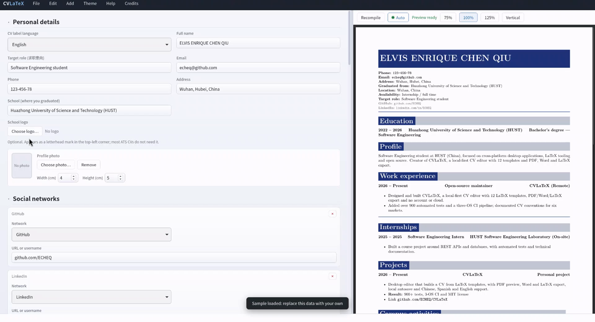

# Competition package — 2026 HUST Excellent Open Source Project

> 中文项目说明：[README.zh.md](../../README.zh.md) · English: [README.md](../../README.md)

Working notes and submission material for the **2026 年华中科技大学优秀开源项目
征集与评选** (HUST Excellent Open Source Project).

> **Deadline: 30 November 2026.** Register on
> <https://ossrpp.tcode.com.cn/#/> and join the QQ group (1127737348) before
> preparing the final material. After the shortlist, the repository must be
> migrated to <https://git.hust.edu.cn>.

## One-liner

**CVLaTeX is a free, offline, cross-platform CV editor that turns a simple form
into a professional PDF, Word document or LaTeX source — with 12 templates,
Chinese support and no account, subscription or cloud upload.**

## 中文摘要（供校内申报）

CVLaTeX 是一个免费、离线、跨平台的简历编辑器：在表单中填写内容后，可生成专业
PDF、Word 或 LaTeX 源码，内置 12 套模板并支持中文简历。无需账号、订阅或云端
上传，所有数据保存在本机。项目采用 MIT 许可证，提供 Windows、Linux、macOS
构建，测试与 CI 覆盖三个平台。

## Why it fits the call

- **Original open-source software**, first published in 2026, MIT licensed.
- **Runs on Windows, Linux and macOS**, with releases for all three platforms.
- **Privacy by design:** the document, photos and preferences stay on the
  user's machine; nothing is uploaded. The local UI server is token-gated and
  bound to `127.0.0.1`, uploads are size-limited and validated by magic bytes,
  and TinyTeX downloads are checked against pinned SHA-256 digests.
- **Low barrier:** no LaTeX installation is required; the app can install
  TinyTeX on demand.
- **Real users:** students, recent graduates, career changers and
  professionals, including users who have never written LaTeX.

## Demo

45-second demo: first run, sample CV, Chinese template, photo crop and exports.
The full 2–3 minute walkthrough is still pending for the final submission.

Demo script and shot list: [`demo-script.md`](demo-script.md).

## Screenshots

[Insert:Image:{Template gallery: Classic, Harvard, Modern, Chinese}]

[Insert:Image:{Chinese CV compiled with XeLaTeX}]

[Insert:Image:{Word export and LaTeX export side by side}]

## Tutorials

[Insert:Video:{Tutorial 1: from a blank page to the first exported PDF}]

[Insert:Video:{Tutorial 2: switching templates and adapting a CV to a market}]

[Insert:Video:{Tutorial 3: photos, logos and the crop editor}]

[Insert:Image:{Tutorial thumbnail grid}]

## Architecture

[Insert:Image:{Architecture diagram: web UI, pywebview bridge, LaTeX/Word generators}]

The short version:

- `web/` — build-less HTML/CSS/JS interface served by a loopback HTTP server.
- `main.py` — pywebview shell plus the `Api` bridge.
- `latex_gen.py` / `latex_engine.py` — TeX generation and compilation.
- `docx_gen.py` — Word export with python-docx.
- `tex_datos.py` — embedded data block for lossless `.tex` round-trips.

## Market fit

CVLaTeX is designed for multiple hiring markets. Each guide explains the local
conventions and the closest app settings:

- [United States](../markets/en-US.md)
- [United Kingdom](../markets/en-GB.md)
- [Spain](../markets/es-ES.md)
- [Latin America](../markets/es-LATAM.md)
- [China](../markets/zh-CN.md)
- [Russia](../markets/ru-RU.md)

[Insert:Image:{Market matrix: paper size, photo, length and language by market}]

## Quality evidence

- **1027 tests pass** with a LaTeX engine available (918 in the fast suite);
  the PDF compile tests are marked and skip when no engine is installed.
- **CI on three operating systems:** Windows, Linux and macOS build native
  archives on every push; tagged releases verify the tag, archive contents and
  `SHA256SUMS.txt`.
- **Contracts under test:** bridge methods, response envelope keys, schema
  keys, i18n key parity, template signatures and release assets.
- **Reproducible staging:** only `web/`, the 12 templates and public assets
  enter the bundle; personal files are excluded by construction.

## Open source and IP

- **License:** MIT (`LICENSE`).
- **Third-party notices:** `THIRD_PARTY_NOTICES.md` lists PDF.js (Apache-2.0,
  local `web/pdfjs/LICENSE`), pywebview (BSD-3-Clause), python-docx (MIT) and
  PyInstaller.
- **Templates:** original layouts maintained in this repository.
- **No secrets or personal data** in the repository; `.cvjson`, PDFs, photos
  and local tooling are ignored.

## Roadmap

- System-font selection in Preferences (requires XeLaTeX; install on demand).
- Russian document labels for the CV itself.
- Coverage reporting and a JavaScript test harness.
- Signed Windows/macOS builds.

## Submission checklist

- [ ] Register on the platform before **30 November 2026**.
- [ ] Join the QQ group and follow the announced rubric.
- [ ] Publish a stable release (not a pre-release) with notes and checksums.
- [ ] Record the 2–3 minute demo and add the screenshots.
- [ ] Replace every `[Insert:Image:...]` / `[Insert:Video:...]` placeholder.
- [ ] Verify the MIT license, third-party notices and the absence of personal
      data.
- [ ] Prepare the `git.hust.edu.cn` mirror for the shortlist stage.
- [ ] Rehearse a 5-minute pitch: problem, demo, architecture, impact, roadmap.
